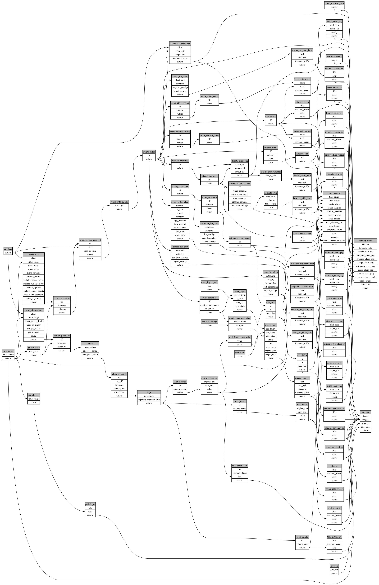

```
# AUTOGENERATED BY ECOSCOPE-WORKFLOWS; see fingerprint in README.md for details

```

```yaml
# fingerprint:
artifacts_sha256_basic: 286b7c8246c809f938c19b9c6fa06277a53c89e3009e4eb31044ba8b773bdcf5
artifacts_sha256_strict: 188499b6d0ed592a1460bfa11d8c04085451d6d7b0b4cc74058251692ab11c31
installed_requirements:
- channel: https://repo.prefix.dev/ecoscope-workflows/
  name: ecoscope-platform
  version: {version: ==2.25.3}
- channel: https://repo.prefix.dev/ecoscope-workflows-custom/
  name: ecoscope-workflows-ext-custom
  version: {version: ==0.1.1}
- channel: conda-forge
  name: pydeck
  version: {version: ==0.9.2}
- channel: https://repo.prefix.dev/ecoscope-workflows-custom/
  name: ecoscope-workflows-ext-icmbio
  version: {version: ==0.0.7}
params_sha256: dcbcccfeae5ebd3c05559fbf4f363c328014357fef2ced8ad8ca574699c8c90f
spec_sha256: 5a7f6b9e35d7b3b09f68cd6ca200d8fcee29d8f49e1c010d585a4f1114089e13

```

# ecoscope-workflows-hunting-intelligence-workflow


